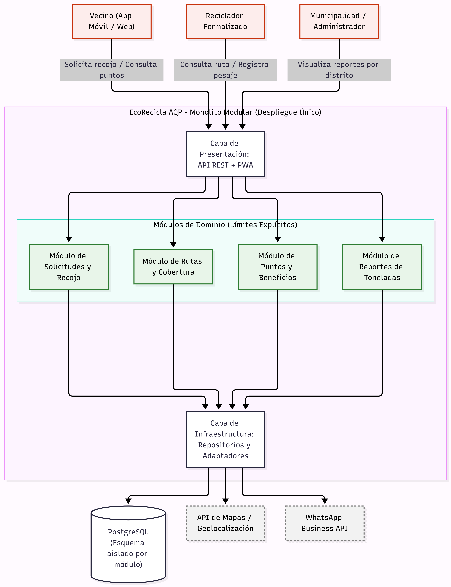
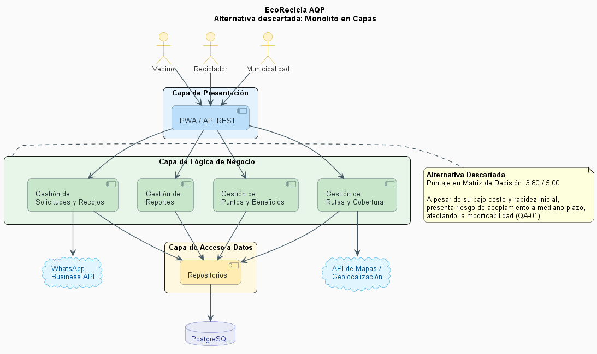
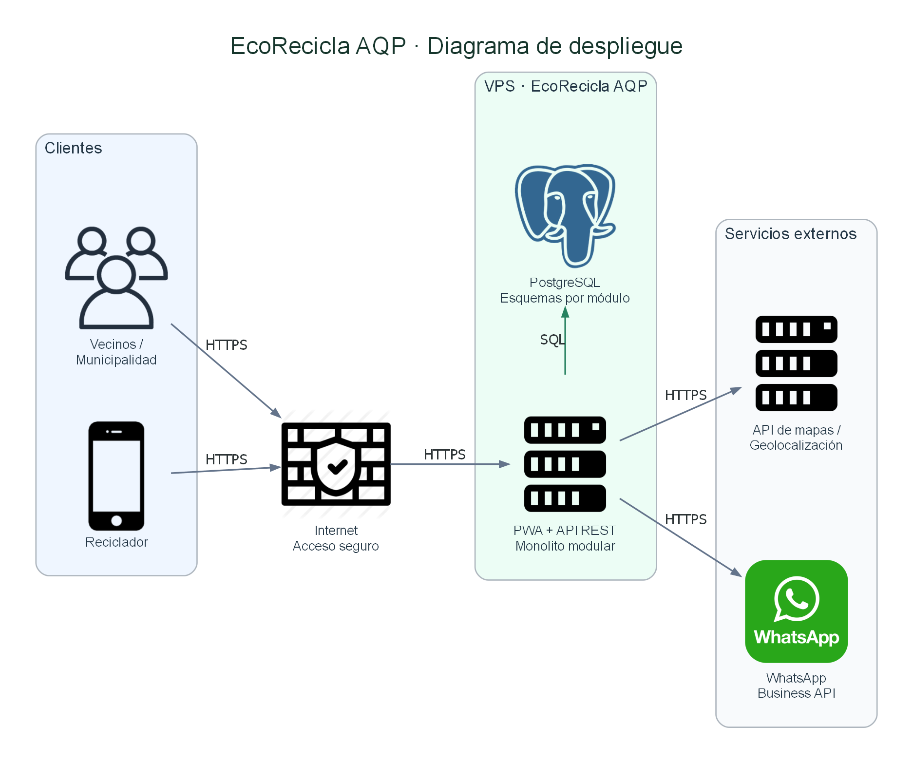
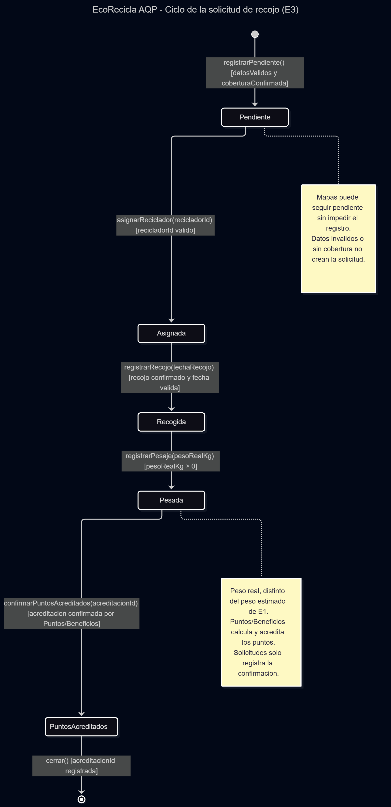

# EcoRecicla AQP — Grupo 10

## 1. Descripción del caso

EcoRecicla AQP es una propuesta de sistema orientada a apoyar la gestión del reciclaje en Arequipa. El sistema permite que los vecinos soliciten recojos de residuos reciclables, que los recicladores consulten sus rutas y registren las entregas realizadas, y que la municipalidad consulte reportes de toneladas recicladas.

El atributo de calidad crítico identificado es la **modificabilidad**, debido a que el sistema debe permitir incorporar nuevos distritos o nuevas reglas de canje de puntos en un máximo de 2 días-persona sin afectar los demás módulos.

---

## 2. Integrantes y roles

| Integrante | Rol / Responsabilidad |
|---|---|
| Paola Adamari Mayta Quispe | Diagramas arquitectónicos, despliegue y bitácora de IA |
| Joselin Sharon Condori Catunta | Drivers arquitectónicos, matriz de decisión y ADR |

## 3. Arquitectura seleccionada

Luego de evaluar las alternativas **Monolito en Capas**, **Microservicios** y **Monolito Modular**, se seleccionó **Monolito Modular**.

Esta alternativa permite mantener un único despliegue y una operación sencilla, pero separando las funcionalidades mediante módulos de dominio con límites explícitos.

Los módulos principales son:

- Solicitudes y Recojo
- Rutas y Cobertura
- Puntos y Beneficios
- Reportes de Toneladas

### Diagrama de arquitectura



---

## 4. Decisiones arquitectónicas

Las principales decisiones del proyecto se encuentran documentadas mediante ADR:

- [ADR-001 — Adopción del Monolito Modular](docs/architecture/adr/001-estilo-arquitectonico.md)
- [ADR-002 — PostgreSQL con esquemas aislados por módulo](docs/architecture/adr/002-base-de-datos.md)
- [ADR-003 — Progressive Web App (PWA)](docs/architecture/adr/003-aplicacion-frontend.md)

---

## 5. Alternativa descartada

Como segunda alternativa se evaluó un **Monolito en Capas**. Aunque ofrece simplicidad y rapidez inicial, se descartó frente al Monolito Modular debido a que este último permite establecer límites de dominio más explícitos y responde mejor al atributo crítico de modificabilidad.



---

## 6. Diagrama de despliegue

El despliegue propuesto utiliza un VPS para alojar la PWA, la API REST y el Monolito Modular. PostgreSQL almacena los datos mediante esquemas por módulo y el sistema se comunica mediante HTTPS con servicios externos de mapas/geolocalización y WhatsApp Business API.



---

## 7. Diseño UML (Lab 05)

En esta sección se consolidan los artefactos de diseño orientado a objetos y modelado UML 2.5.1 desarrollados para el módulo de **Solicitudes de Recojo**:

### Diagrama de Estados de la Solicitud



### Índice de Entregables de Diseño y Diagramas (E1 al E7)

| Entregable | Artefacto / Diagramas de Diseño | Enlaces a Archivos |
|---|---|---|
| **E1** | Historia de Usuario y Diagrama de Clases | [`docs/design/historia.md`](docs/design/historia.md) \| [`docs/design/clases.puml`](docs/design/clases.puml) \| [`docs/design/img/clases-solicitudes.png`](docs/design/img/clases-solicitudes.png) |
| **E2** | Diagrama de Secuencia (Solicitar Recojo) | [`docs/design/secuencia-solicitar-recojo.puml`](docs/design/secuencia-solicitar-recojo.puml) \| [`docs/design/img/secuencia-solicitar-recojo.png`](docs/design/img/secuencia-solicitar-recojo.png) |
| **E3** | Máquina de Estados (Ciclo de Vida) | [`docs/design/estados-solicitud.mmd`](docs/design/estados-solicitud.mmd) \| [`docs/design/img/estados-solicitud.png`](docs/design/img/estados-solicitud.png) |
| **E4** | Diagrama de Actividades (Recorrido del Reciclador) | [`docs/design/actividades-ruta-diaria.puml`](docs/design/actividades-ruta-diaria.puml) \| [`docs/design/img/actividades-ruta-diaria.png`](docs/design/img/actividades-ruta-diaria.png) |
| **E5** | Diagrama de Paquetes (Regla C4 - Sin Ciclos) | [`docs/design/paquetes.puml`](docs/design/paquetes.puml) \| [`docs/design/img/paquetes.png`](docs/design/img/paquetes.png) |
| **E6** | Esqueleto Python y Análisis Round-Trip | [`src/solicitudes/dominio.py`](src/solicitudes/dominio.py) \| [`docs/design/round-trip.md`](docs/design/round-trip.md) \| [Diagrama inverso](docs/design/classes_solicitudes.puml) \| [Imagen inversa](docs/design/img/classes_solicitudes.png) |
| **E7** | Auditoría de Consistencia C1–C5 | [`docs/design/consistencia.md`](docs/design/consistencia.md) |

---

## 8. Uso de Inteligencia Artificial

Durante el laboratorio se utilizó IA como herramienta de apoyo para analizar alternativas arquitectónicas, revisar decisiones, generar propuestas de Diagram as Code y realizar la ingeniería directa e inversa (Round-Trip).

Todas las propuestas fueron verificadas y auditadas por el equipo antes de ser aceptadas. Los registros detallados se encuentran en:

- [Bitácora de uso de IA — Lab 04 (Arquitectura)](docs/architecture/bitacora-ia.md)
- [Bitácora de uso de IA — Lab 05 (Diseño UML)](docs/design/bitacora-ia.md)
- [Bitácora de uso de IA — Lab 06 (Modelo C4)](docs/architecture/c4/bitacora-ia.md)

---

## 9. Reflexión del equipo

El desarrollo de este laboratorio nos permitió comprender que seleccionar una arquitectura no consiste únicamente en elegir la tecnología más avanzada, sino en analizar los requisitos, atributos de calidad y restricciones reales del proyecto. La matriz de decisión nos ayudó a comparar las alternativas de manera más objetiva y justificar la elección del Monolito Modular. También aprendimos a documentar las decisiones mediante ADR y a representar la arquitectura utilizando Mermaid, PlantUML y Python Diagrams.

Asimismo, la integración del diseño UML en el Laboratorio 05 nos enseñó la importancia de conectar las decisiones de arquitectura de alto nivel con la estructura del código mediante técnicas de Round-Trip, verificando que los diagramas mantengan consistencia estricta con las reglas del dominio (C1 a C5). El uso de IA permitió acelerar algunas actividades, pero comprobamos que sus propuestas deben ser verificadas minuciosamente antes de incorporarlas al proyecto. Finalmente, entendimos la importancia de mantener los diagramas, código y decisiones arquitectónicas versionados conjuntamente en el repositorio.


---

## Arquitectura C4 (Lab 06)

El modelo C4 describe EcoRecicla AQP desde sus usuarios y servicios externos hasta los componentes internos y su despliegue. Se mantiene el monolito modular del ADR-001, PostgreSQL con esquemas por módulo del ADR-002 y la PWA del ADR-003. Las cinco vistas se generan desde [workspace.dsl](docs/architecture/c4/workspace.dsl).

### Contexto del sistema

El siguiente bloque se copia de la [exportación Mermaid del contexto](docs/architecture/c4/export/structurizr-VistaContexto.mmd). También puede consultarse su [imagen PNG](docs/architecture/c4/img/structurizr-VistaContexto.png).

```mermaid
graph LR
  linkStyle default fill:#ffffff

  subgraph diagram ["Diagrama de Contexto del Sistema EcoRecicla AQP"]
    style diagram fill:#ffffff,stroke:#ffffff

    1["<div style='font-weight: bold'>Vecino / Ciudadano</div><div style='font-size: 70%; margin-top: 0px'>[Person]</div><div style='font-size: 80%; margin-top:10px'>Residente de Arequipa que<br />solicita el recojo de<br />residuos reciclables y<br />acumula puntos de beneficio.</div>"]
    style 1 fill:#08427b,stroke:#052e56,color:#ffffff
    2["<div style='font-weight: bold'>Reciclador / Operador</div><div style='font-size: 70%; margin-top: 0px'>[Person]</div><div style='font-size: 80%; margin-top:10px'>Personal operativo que<br />atiende las rutas de recojo,<br />registra pesajes y gestiona<br />atenciones.</div>"]
    style 2 fill:#1168cb,stroke:#0b488e,color:#ffffff
    3["<div style='font-weight: bold'>Administrador Municipal</div><div style='font-size: 70%; margin-top: 0px'>[Person]</div><div style='font-size: 80%; margin-top:10px'>Personal encargado de<br />consultar reportes e<br />indicadores de reciclaje<br />municipal.</div>"]
    style 3 fill:#228b22,stroke:#176117,color:#ffffff
    4["<div style='font-weight: bold'>Servicio de Mapas y Geolocalizacion</div><div style='font-size: 70%; margin-top: 0px'>[Software System]</div><div style='font-size: 80%; margin-top:10px'>Servicio externo utilizado<br />para validar coordenadas<br />geograficas de los puntos de<br />recojo.</div>"]
    style 4 fill:#999999,stroke:#6b6b6b,color:#ffffff
    5["<div style='font-weight: bold'>API de Notificaciones WhatsApp</div><div style='font-size: 70%; margin-top: 0px'>[Software System]</div><div style='font-size: 80%; margin-top:10px'>Servicio externo para el<br />envio asincrono de mensajes y<br />alertas de confirmacion.</div>"]
    style 5 fill:#999999,stroke:#6b6b6b,color:#ffffff
    6["<div style='font-weight: bold'>EcoRecicla AQP</div><div style='font-size: 70%; margin-top: 0px'>[Software System]</div><div style='font-size: 80%; margin-top:10px'>Plataforma municipal para la<br />gestion integral de recojo,<br />pesaje y acreditacion de<br />reciclaje.</div>"]
    style 6 fill:#1168cb,stroke:#0b488e,color:#ffffff

    6-. "<div>Valida coordenadas<br />geograficas de los puntos de<br />recojo</div><div style='font-size: 70%'></div>" .->4
    6-. "<div>Envia avisos y notificaciones<br />de confirmacion de recojo</div><div style='font-size: 70%'></div>" .->5
    1-. "<div>Registra solicitudes de<br />recojo de reciclables y<br />consulta sus puntos</div><div style='font-size: 70%'></div>" .->6
    2-. "<div>Consulta rutas asignadas,<br />atiende recojos y registra<br />pesajes in situ</div><div style='font-size: 70%'></div>" .->6
    3-. "<div>Consulta reportes de pesaje e<br />indicadores de reciclaje<br />municipal</div><div style='font-size: 70%'></div>" .->6

  end```

### Vistas de arquitectura

| Vista | Alcance | Imagen | C4-PlantUML | Mermaid |
| --- | --- | --- | --- | --- |
| Contexto | Vecinos, recicladores, administración municipal y servicios externos | [PNG](docs/architecture/c4/img/structurizr-VistaContexto.png) | [Fuente](docs/architecture/c4/export/structurizr-VistaContexto.puml) | [Fuente](docs/architecture/c4/export/structurizr-VistaContexto.mmd) |
| Contenedores | PWA, API REST y PostgreSQL | [PNG](docs/architecture/c4/img/structurizr-VistaContenedores.png) | [Fuente](docs/architecture/c4/export/structurizr-VistaContenedores.puml) | [Fuente](docs/architecture/c4/export/structurizr-VistaContenedores.mmd) |
| Componentes | Cuatro módulos de dominio, Notificaciones como auxiliar y tipos compartidos | [PNG](docs/architecture/c4/img/structurizr-VistaComponentes.png) | [Fuente](docs/architecture/c4/export/structurizr-VistaComponentes.puml) | [Fuente](docs/architecture/c4/export/structurizr-VistaComponentes.mmd) |
| Dinámica | Solicitar el recojo de reciclables, escenario con datos y cobertura válidos | [PNG](docs/architecture/c4/img/structurizr-VistaDinamica.png) | [Fuente](docs/architecture/c4/export/structurizr-VistaDinamica.puml) | [Fuente](docs/architecture/c4/export/structurizr-VistaDinamica.mmd) |
| Despliegue | Dispositivo del usuario y un único VPS, capacidad propuesta para el MVP | [PNG](docs/architecture/c4/img/structurizr-VistaDespliegue.png) | [Fuente](docs/architecture/c4/export/structurizr-VistaDespliegue.puml) | [Fuente](docs/architecture/c4/export/structurizr-VistaDespliegue.mmd) |

Las exportaciones e imágenes se regeneran al modificar el modelo. Los PNG se renderizaron y revisaron con PlantUML. La renderización Mermaid no se verificó en esta sesión, se conservan sus fuentes exportadas y la alternativa PNG. Para componentes se recomienda abrir la imagen a tamaño completo.

### Documentación y comprobaciones

- [Inventario y trazabilidad con Lab04 y Lab05](docs/architecture/c4/inventario.md).
- [Contexto C4-PlantUML escrito a mano](docs/architecture/c4/contexto-manual.puml) y su [PNG](docs/architecture/c4/img/contexto-manual.png).
- [Comparación UML/C4 y herramientas, con comandos de regeneración](docs/architecture/c4/comparacion.md).
- [Lista de revisión de las cinco vistas y limitaciones identificadas](docs/architecture/c4/revision-c4.md).
- [Explicación para la administración municipal](docs/architecture/c4/explicacion.md).
- [Bitácora de prompts, propuestas y verificaciones](docs/architecture/c4/bitacora-ia.md).

La validación con Structurizr y las comprobaciones de coherencia del modelo no sustituyen las pruebas de una implementación en producción. El tamaño del VPS es una propuesta, pendiente de cotización y medición.

### Revisión cruzada entre grupos y entrega

| Actividad requerida por E8 | Estado | Evidencia |
| --- | --- | --- |
| Revisar los contenedores de otro grupo con la lista oficial y registrar observaciones en un issue de su repositorio | Pendiente | Aún no se ha asignado otro grupo para la revisión, por lo que todavía no hay issue. |
| Responder o corregir las observaciones de otro grupo sobre EcoRecicla AQP | Pendiente | Falta el enlace de la revisión recibida y su respuesta. |
| Revisión de los PR de E6, E7 y E8 antes de integrar en main | Pendiente | Se completará con la revisión del equipo. |
| Crear y publicar la etiqueta v0.6-c4 sobre la versión final revisada e integrada | Pendiente | La etiqueta todavía no se ha creado. |
| Entregar el enlace del repositorio en el Aula Virtual | Pendiente de confirmación del equipo | No se registra una entrega que no se ha comprobado. |

La revisión de PR entre compañeras y la revisión cruzada entre grupos son actividades distintas. El repositorio para la entrega es https://github.com/SharonCondoriUNSA/cs-2026b-lab04-grupo10. La evidencia pendiente se actualizará cuando se realice, antes de cerrar la entrega del laboratorio.
