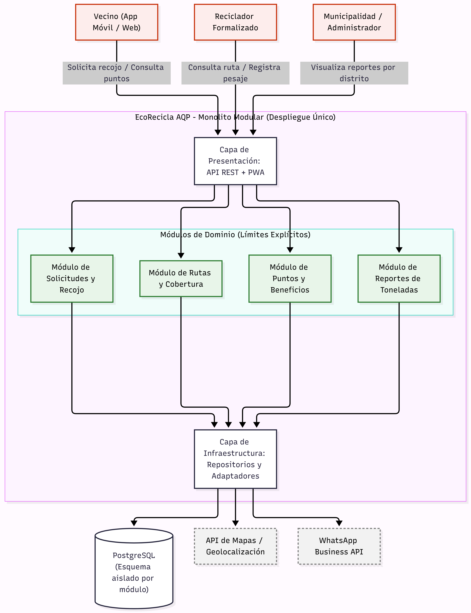
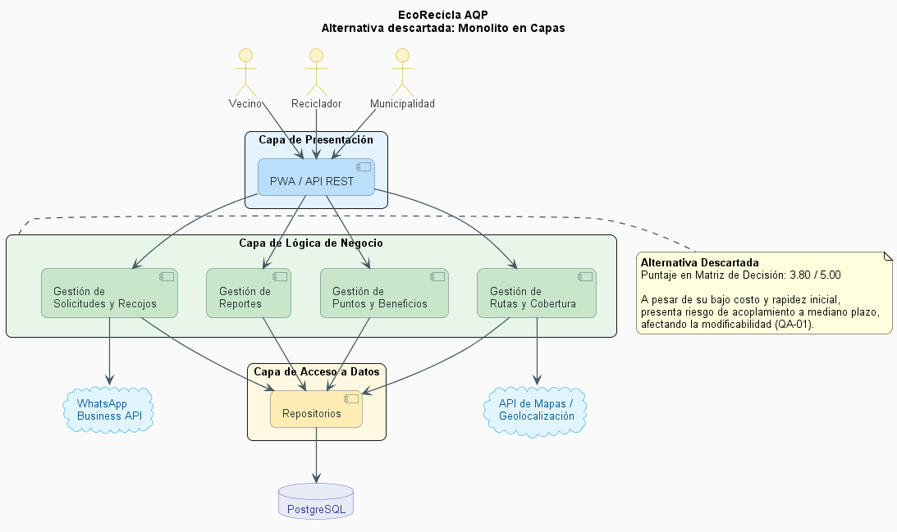
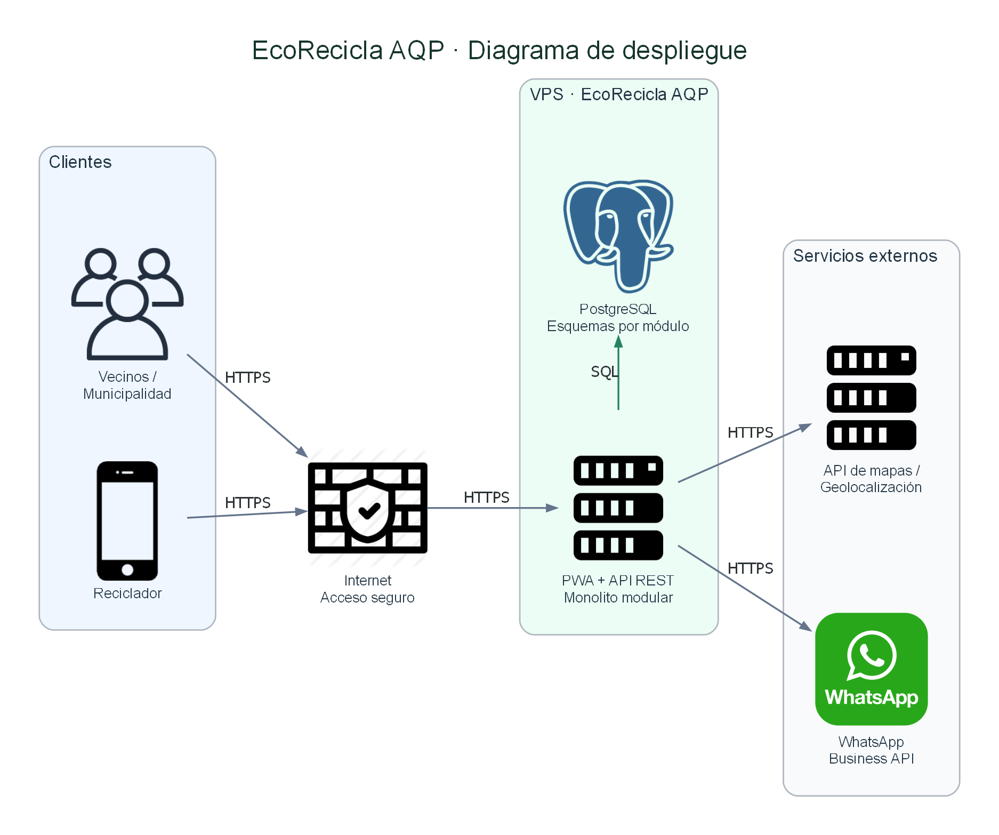
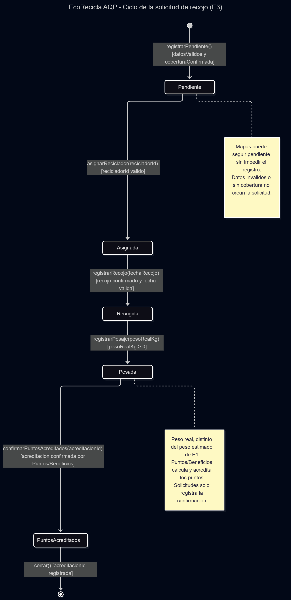
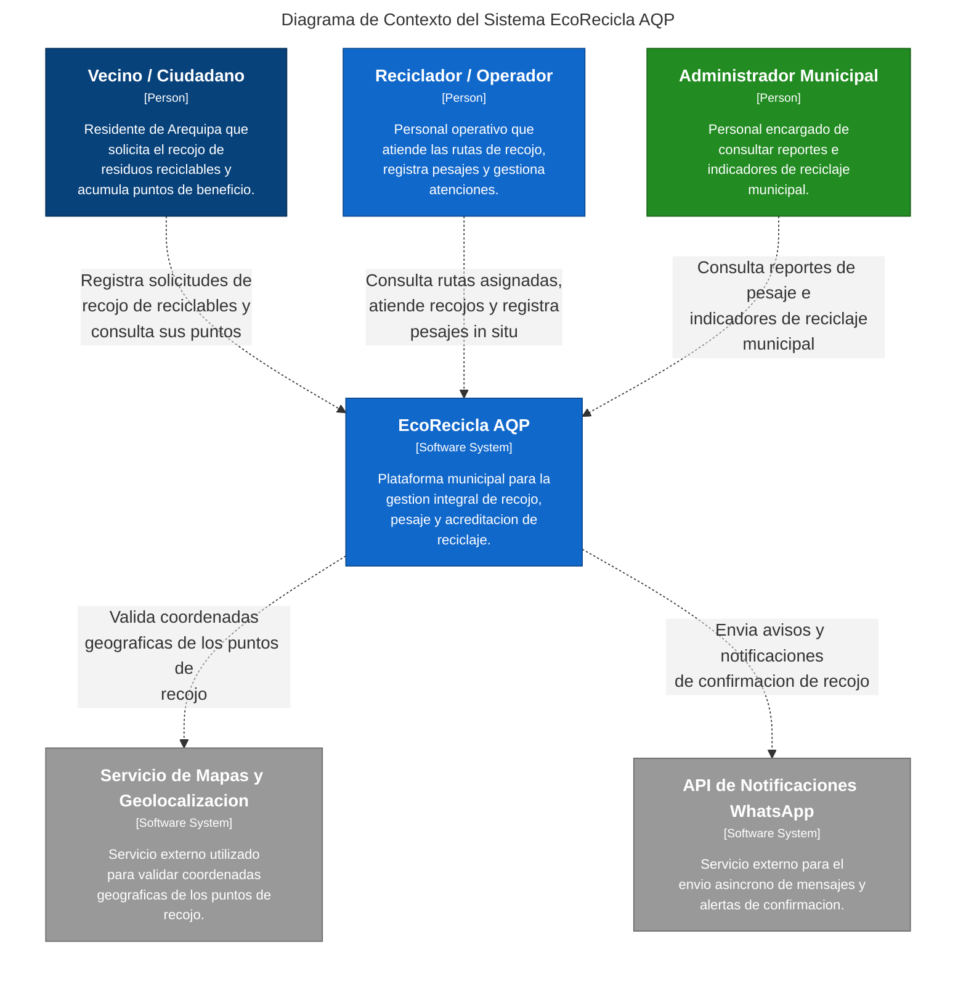
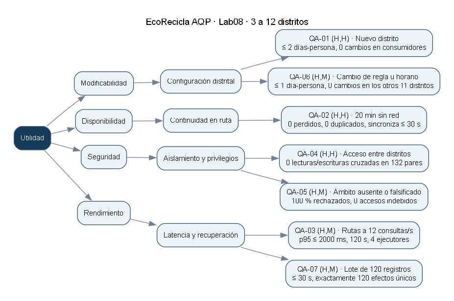

# EcoRecicla AQP — Grupo 10

## 1. Descripción del caso

EcoRecicla AQP es una propuesta de sistema orientada a apoyar la gestión del reciclaje en Arequipa. El sistema permite que los vecinos soliciten recojos de residuos reciclables, que los recicladores consulten sus rutas y registren las entregas realizadas, y que la municipalidad consulte reportes de toneladas recicladas.

El atributo de calidad crítico identificado es la **modificabilidad**, debido a que el sistema debe permitir incorporar nuevos distritos o nuevas reglas de canje de puntos en un máximo de 2 días-persona sin afectar los demás módulos.

---

## 2. Integrantes y roles

| Integrante | Rol / Responsabilidad |
|---|---|
| Paola Adamari Mayta Quispe | Diagramas arquitectónicos, despliegue y bitácora de IA |
| Joselin Sharon Condori Catunta | Drivers arquitectónicos, matriz de decisión y ADR |

## 3. Arquitectura seleccionada

Luego de evaluar las alternativas **Monolito en Capas**, **Microservicios** y **Monolito Modular**, se seleccionó **Monolito Modular**.

Esta alternativa permite mantener un único despliegue y una operación sencilla, pero separando las funcionalidades mediante módulos de dominio con límites explícitos.

Los módulos principales son:

- Solicitudes y Recojo
- Rutas y Cobertura
- Puntos y Beneficios
- Reportes de Toneladas

### Diagrama de arquitectura

---

## 4. Decisiones arquitectónicas

Las principales decisiones del proyecto se encuentran documentadas mediante ADR:

- [ADR-001 — Adopción del Monolito Modular](docs/architecture/adr/001-estilo-arquitectonico.md)
- [ADR-002 — PostgreSQL con esquemas aislados por módulo](docs/architecture/adr/002-base-de-datos.md)
- [ADR-003 — Progressive Web App (PWA)](docs/architecture/adr/003-aplicacion-frontend.md)

---

## 5. Alternativa descartada

Como segunda alternativa se evaluó un **Monolito en Capas**. Aunque ofrece simplicidad y rapidez inicial, se descartó frente al Monolito Modular debido a que este último permite establecer límites de dominio más explícitos y responde mejor al atributo crítico de modificabilidad.

---

## 6. Diagrama de despliegue

El despliegue propuesto utiliza un VPS para alojar la PWA, la API REST y el Monolito Modular. PostgreSQL almacena los datos mediante esquemas por módulo y el sistema se comunica mediante HTTPS con servicios externos de mapas/geolocalización y WhatsApp Business API.

---

## 7. Diseño UML (Lab 05)

En esta sección se consolidan los artefactos de diseño orientado a objetos y modelado UML 2.5.1 desarrollados para el módulo de **Solicitudes de Recojo**:

### Diagrama de Estados de la Solicitud

### Índice de Entregables de Diseño y Diagramas (E1 al E7)

| Entregable | Artefacto / Diagramas de Diseño | Enlaces a Archivos |
|---|---|---|
| **E1** | Historia de Usuario y Diagrama de Clases | [`docs/design/historia.md`](docs/design/historia.md) \| [`docs/design/clases.puml`](docs/design/clases.puml) \| [`docs/design/img/clases-solicitudes.png`](docs/design/img/clases-solicitudes.png) |
| **E2** | Diagrama de Secuencia (Solicitar Recojo) | [`docs/design/secuencia-solicitar-recojo.puml`](docs/design/secuencia-solicitar-recojo.puml) \| [`docs/design/img/secuencia-solicitar-recojo.png`](docs/design/img/secuencia-solicitar-recojo.png) |
| **E3** | Máquina de Estados (Ciclo de Vida) | [`docs/design/estados-solicitud.mmd`](docs/design/estados-solicitud.mmd) \| [`docs/design/img/estados-solicitud.png`](docs/design/img/estados-solicitud.png) |
| **E4** | Diagrama de Actividades (Recorrido del Reciclador) | [`docs/design/actividades-ruta-diaria.puml`](docs/design/actividades-ruta-diaria.puml) \| [`docs/design/img/actividades-ruta-diaria.png`](docs/design/img/actividades-ruta-diaria.png) |
| **E5** | Diagrama de Paquetes (Regla C4 - Sin Ciclos) | [`docs/design/paquetes.puml`](docs/design/paquetes.puml) \| [`docs/design/img/paquetes.png`](docs/design/img/paquetes.png) |
| **E6** | Esqueleto Python y Análisis Round-Trip | [`src/solicitudes/dominio.py`](src/solicitudes/dominio.py) \| [`docs/design/round-trip.md`](docs/design/round-trip.md) \| [Diagrama inverso](docs/design/classes_solicitudes.puml) \| [Imagen inversa](docs/design/img/classes_solicitudes.png) |
| **E7** | Auditoría de Consistencia C1–C5 | [`docs/design/consistencia.md`](docs/design/consistencia.md) |

---

## 8. Uso de Inteligencia Artificial

Durante el laboratorio se utilizó IA como herramienta de apoyo para analizar alternativas arquitectónicas, revisar decisiones, generar propuestas de Diagram as Code y realizar la ingeniería directa e inversa (Round-Trip).

Todas las propuestas fueron verificadas y auditadas por el equipo antes de ser aceptadas. Los registros detallados se encuentran en:

- [Bitácora de uso de IA — Lab 04 (Arquitectura)](docs/architecture/bitacora-ia.md)
- [Bitácora de uso de IA — Lab 05 (Diseño UML)](docs/design/bitacora-ia.md)
- [Bitácora de uso de IA — Lab 06 (Modelo C4)](docs/architecture/c4/bitacora-ia.md)

---

## 9. Reflexión del equipo

El desarrollo de este laboratorio nos permitió comprender que seleccionar una arquitectura no consiste únicamente en elegir la tecnología más avanzada, sino en analizar los requisitos, atributos de calidad y restricciones reales del proyecto. La matriz de decisión nos ayudó a comparar las alternativas de manera más objetiva y justificar la elección del Monolito Modular. También aprendimos a documentar las decisiones mediante ADR y a representar la arquitectura utilizando Mermaid, PlantUML y Python Diagrams.

Asimismo, la integración del diseño UML en el Laboratorio 05 nos enseñó la importancia de conectar las decisiones de arquitectura de alto nivel con la estructura del código mediante técnicas de Round-Trip, verificando que los diagramas mantengan consistencia estricta con las reglas del dominio (C1 a C5). El uso de IA permitió acelerar algunas actividades, pero comprobamos que sus propuestas deben ser verificadas minuciosamente antes de incorporarlas al proyecto. Finalmente, entendimos la importancia de mantener los diagramas, código y decisiones arquitectónicas versionados conjuntamente en el repositorio.

---

## Arquitectura C4 (Lab 06)

El modelo C4 describe EcoRecicla AQP desde sus usuarios y servicios externos hasta los componentes internos y su despliegue. Se mantiene el monolito modular del ADR-001, PostgreSQL con esquemas por módulo del ADR-002 y la PWA del ADR-003. Las cinco vistas se generan desde [workspace.dsl](docs/architecture/c4/workspace.dsl).

### Contexto del sistema

El siguiente bloque se copia de la [exportación Mermaid del contexto](docs/architecture/c4/export/structurizr-VistaContexto.mmd). También puede consultarse su [imagen PNG](docs/architecture/c4/img/structurizr-VistaContexto.png).

### Vistas de arquitectura

| Vista | Alcance | Imagen | C4-PlantUML | Mermaid |
| --- | --- | --- | --- | --- |
| Contexto | Vecinos, recicladores, administración municipal y servicios externos | [PNG](docs/architecture/c4/img/structurizr-VistaContexto.png) | [Fuente](docs/architecture/c4/export/structurizr-VistaContexto.puml) | [Fuente](docs/architecture/c4/export/structurizr-VistaContexto.mmd) |
| Contenedores | PWA, API REST y PostgreSQL | [PNG](docs/architecture/c4/img/structurizr-VistaContenedores.png) | [Fuente](docs/architecture/c4/export/structurizr-VistaContenedores.puml) | [Fuente](docs/architecture/c4/export/structurizr-VistaContenedores.mmd) |
| Componentes | Cuatro módulos de dominio, Notificaciones como auxiliar y tipos compartidos | [PNG](docs/architecture/c4/img/structurizr-VistaComponentes.png) | [Fuente](docs/architecture/c4/export/structurizr-VistaComponentes.puml) | [Fuente](docs/architecture/c4/export/structurizr-VistaComponentes.mmd) |
| Dinámica | Solicitar el recojo de reciclables, escenario con datos y cobertura válidos | [PNG](docs/architecture/c4/img/structurizr-VistaDinamica.png) | [Fuente](docs/architecture/c4/export/structurizr-VistaDinamica.puml) | [Fuente](docs/architecture/c4/export/structurizr-VistaDinamica.mmd) |
| Despliegue | Dispositivo del usuario y un único VPS, capacidad propuesta para el MVP | [PNG](docs/architecture/c4/img/structurizr-VistaDespliegue.png) | [Fuente](docs/architecture/c4/export/structurizr-VistaDespliegue.puml) | [Fuente](docs/architecture/c4/export/structurizr-VistaDespliegue.mmd) |

Las exportaciones e imágenes se regeneran al modificar el modelo. Los PNG se renderizaron y revisaron con PlantUML. La renderización Mermaid no se verificó en esta sesión, se conservan sus fuentes exportadas y la alternativa PNG. Para componentes se recomienda abrir la imagen a tamaño completo.

### Documentación y comprobaciones

- [Inventario y trazabilidad con Lab04 y Lab05](docs/architecture/c4/inventario.md).
- [Contexto C4-PlantUML escrito a mano](docs/architecture/c4/contexto-manual.puml) y su [PNG](docs/architecture/c4/img/contexto-manual.png).
- [Comparación UML/C4 y herramientas, con comandos de regeneración](docs/architecture/c4/comparacion.md).
- [Lista de revisión de las cinco vistas y limitaciones identificadas](docs/architecture/c4/revision-c4.md).
- [Explicación para la administración municipal](docs/architecture/c4/explicacion.md).
- [Bitácora de prompts, propuestas y verificaciones](docs/architecture/c4/bitacora-ia.md).

La validación con Structurizr y las comprobaciones de coherencia del modelo no sustituyen las pruebas de una implementación en producción. El tamaño del VPS es una propuesta, pendiente de cotización y medición.

### Revisión cruzada entre grupos y entrega

| Actividad requerida por E8 | Estado | Evidencia |
| --- | --- | --- |
| Revisión de los contenedores por parte del docente encargado del curso de construcción de software | Pendiente | Aún se realizará la revisión por parte del docente. |
| Responder o corregir las observaciones realizadas por parte del docente del curso  | Pendiente | Falta el enlace de la revisión . |
  | Revisión de los PR de E6, E7 y E8 antes de integrar en main | Realizado | Se completó la revisión de las ramas E6 al E8 y se hizo el merge respectivo. |
| Crear y publicar la etiqueta v0.6-c4 sobre la versión final revisada e integrada | Realizado | La etiqueta se creó con éxito. |
| Entregar el enlace del repositorio en el Aula Virtual | Realizado | Se registro la entrega en el aula virtual. |

La revisión de PR entre compañeras y la revisión cruzada entre grupos son actividades distintas. El repositorio para la entrega es https://github.com/SharonCondoriUNSA/cs-2026b-lab04-grupo10. La evidencia pendiente se actualizará cuando se realice, antes de cerrar la entrega del laboratorio.

## Patrones de diseño (Lab 07)

El refactor del flujo de solicitudes aplica patrones únicamente a responsabilidades observadas en la línea base. El [ADR-005](docs/architecture/adr/005-patrones-de-diseno.md) registra la decisión y sus alternativas. Los diagramas PlantUML y PNG están en [docs/design/patrones](docs/design/patrones/e7-diagramas.md).

### Olor, patrón y prueba

| Olor / responsabilidad | Patrón aplicado | Prueba representativa |
|---|---|---|
| Selección de regla por material dentro del servicio de puntos | Strategy + Factory por registro | [test_open_closed_agrega_regla_sin_modificar_servicio](tests/test_patrones.py) |
| Acoplamiento a formatos distintos de los SDK de mapas | Adapter | [test_adapters_conservan_resultado_del_proveedor](tests/test_patrones.py) |
| Selección del proveedor de mapas mediante ramas condicionales | Factory por registro | [test_open_closed_agrega_mapa_sin_modificar_solicitudes](tests/test_patrones.py) |
| Transiciones y guardas distribuidas en condicionales | State | [test_state_recorrido_completo_del_diagrama](tests/test_patrones.py), [test_state_prohibe_transiciones_fuera_del_estado](tests/test_patrones.py) |
| Avisos agregados manualmente por el servicio | Observer | [test_observer_dos_suscriptores_reciben_despues_de_persistir](tests/test_patrones.py) |
| Reintentos mezclados con la consulta de mapas | Decorator | [test_decorator_recuperacion_y_limite_de_tres_intentos](tests/test_patrones.py) |
| Dependencia del clasificador respecto a la interfaz del cliente LLM | Adapter | [test_adapter_traduce_respuesta_del_cliente_al_puerto](tests/test_patrones.py) |
| Repetición de llamadas para una misma descripción | Decorator de caché | [test_decorator_cachea_resultado_validado_para_entrada_equivalente](tests/test_patrones.py) |
| Salida de IA libre o fuera del catálogo permitido | Chain of Responsibility | [test_guardrails_bloquean_respuesta_invalida](tests/test_patrones.py), [test_cadena_exige_dos_guardrails_y_detiene_respuesta_vacia](tests/test_patrones.py) |

### Métricas

Las métricas se calcularon con Radon 6.0.1. La comparación del componente E5 se separa porque no tiene una contraparte en la versión inicial.

| Versión / alcance | Bloques Radon | Complejidad promedio | SLOC |
|---|---:|---:|---:|
| Antes, E1 | 17 | 5.12 (B) | 150 |
| Después, E1-E4 | 86 | 2.07 (A) | 300 |
| Componente nuevo, E5 | 28 | 2.11 (A) | 100 |
| Después acumulado, E1-E5 | 114 | 2.08 (A) | 400 |

La complejidad de solicitar_recojo bajó de 25 (D) a 15 (C) entre la línea base y E1-E4; acreditar de Puntos/Beneficios bajó de 9 (B) a 1 (A). La reducción por método no elimina toda la lógica del flujo, que ahora está repartida entre estados, reglas y colaboradores. El refactor duplica SLOC en E1-E4 y agrega 100 SLOC para la nueva función E5. Véanse el [detalle de métricas y trade-off](docs/design/patrones/metricas.md) y el [registro de Radon](docs/design/patrones/radon-despues.txt).

### Revisión por pares y entrega

**Estado de la revisión cruzada:** E5, E6, E7 y E8 están integrados en main mediante los PR #29, #30, #31 y #32. La corrección de diagramas de E7 está incluida. La revisión general final comprobó 138 casos aprobados, las métricas de Radon, los enlaces locales y la sintaxis de los diagramas. Las observaciones de revisión por integrante se conservan en los Pull Requests.

La versión de entrega se identifica mediante la etiqueta **v0.7-patrones**, sobre el cierre integrado del Lab07. La publicación de la etiqueta no acredita por sí sola la entrega en el Aula Virtual, cuya confirmación corresponde al equipo.

## Diseño de la arquitectura (Lab 08)

El análisis parte del árbol de utilidad y de tres iteraciones ADD para el crecimiento de EcoRecicla AQP de 3 a 12 distritos. Los resultados distinguen los prototipos de las funciones aún propuestas para integración.

### Árbol de utilidad

Consulta también los [escenarios de calidad](docs/architecture/utilidad/escenarios.md) y la [fuente Graphviz](docs/architecture/utilidad/arbol.dot).

### Iteraciones ADD

| Iteración | Escenario | Táctica propuesta | Evidencia | ¿Cumple? |
|---|---|---|---|---|
| ADD 1 | QA-01 / QA-06: incorporar o actualizar reglas de puntos y horarios para 12 distritos sin alterar los demás. | Configuración versionada en Puntos/Beneficios y Rutas/Cobertura; Strategy para fórmulas que realmente varían. | [Iteración](docs/architecture/add/iteracion-1.md), [resultado JSON](docs/architecture/add/evidencia-1.json): 9 distritos incorporados, 24 comprobaciones, 0 cambios en los tres consumidores observados y 0 alteraciones en los otros 11. | **Parcial.** El esfuerzo en días-persona no se midió y la persistencia real no se probó. |
| ADD 2 | QA-02 / QA-07: conservar 120 registros durante 20 min sin red y sincronizar en ≤ 30 s sin pérdidas ni duplicados. | Buffer persistente local con identificadores estables y receptor idempotente en la API. | [Iteración](docs/architecture/add/iteracion-2.md), [resultado JSON](docs/architecture/add/evidencia-2.json): 120 efectos únicos, 0 pérdidas/duplicados y 13.2 s modelados a 100 ms por llamada; 33 s a 250 ms. | **Parcial.** Cumple en el escenario base simulado; la sensibilidad lenta excede 30 s. SQLite sustituye IndexedDB/PostgreSQL y el tiempo es virtual. |
| ADD 3 | QA-04 / QA-05: impedir lectura/escritura entre distritos y rechazar operaciones sin ámbito confiable. | Ámbito distrital derivado de autenticación, guardas en contratos y RLS como defensa adicional propuesta. | [Iteración](docs/architecture/add/iteracion-3.md), [resultado JSON](docs/architecture/add/evidencia-3.json): 264 accesos cruzados rechazados, 72 operaciones sin ámbito rechazadas y 24 operaciones propias permitidas. | **Parcial.** La guarda pasó en el prototipo; JWT, middleware y RLS reales no están implementados ni probados. |

### Decisiones y modelo C4

- [ADR-006 — Configuración versionada por distrito](docs/architecture/adr/006-configuracion-por-distrito.md)
- [ADR-007 — Buffer local y sincronización idempotente](docs/architecture/adr/007-sincronizacion-idempotente.md)
- [ADR-008 — Autorización con ámbito distrital](docs/architecture/adr/008-autorizacion-distrital.md)
- [Fitness functions E5](docs/architecture/fitness-functions.md) y [workflow de GitHub Actions](.github/workflows/fitness.yml).
- [Workspace C4 actualizado](docs/architecture/c4/workspace.dsl) y [vista de contenedores exportada](docs/architecture/c4/export/structurizr-VistaContenedores.puml) ([Mermaid](docs/architecture/c4/export/structurizr-VistaContenedores.mmd)).
- [ATAM-lite y matriz de riesgos](docs/architecture/atam-lite.md) · [Bitácora de IA](docs/architecture/bitacora-ia.md).

### Fitness functions y entrega

El workflow ejecuta los contratos estructurales y las pruebas de calidad en cada Pull Request y push. Las ramas E5–E8 están preparadas localmente; falta publicarlas, abrir y revisar los Pull Requests, y comprobar el estado verde en GitHub antes de aprobarlos.

| Actividad de cierre | Estado | Evidencia / siguiente paso |
|---|---|---|
| Pull Requests de los entregables y revisión | Pendiente | Publicar las ramas E5–E8 y abrir un PR por entregable en orden. La revisión y los merges corresponden a la compañera. |
| Workflow verde antes de aprobar cada PR | Pendiente | Confirmar la ejecución de `fitness.yml` en GitHub para cada PR. |
| Crear la etiqueta `v0.8-arquitectura` | Pendiente | Crear y publicar después de integrar y revisar los entregables en `main`. |
| Entregar el enlace del repositorio en Aula Virtual | Pendiente | Registrar la entrega antes del sábado 31/10/2026 a las 23:59. |
