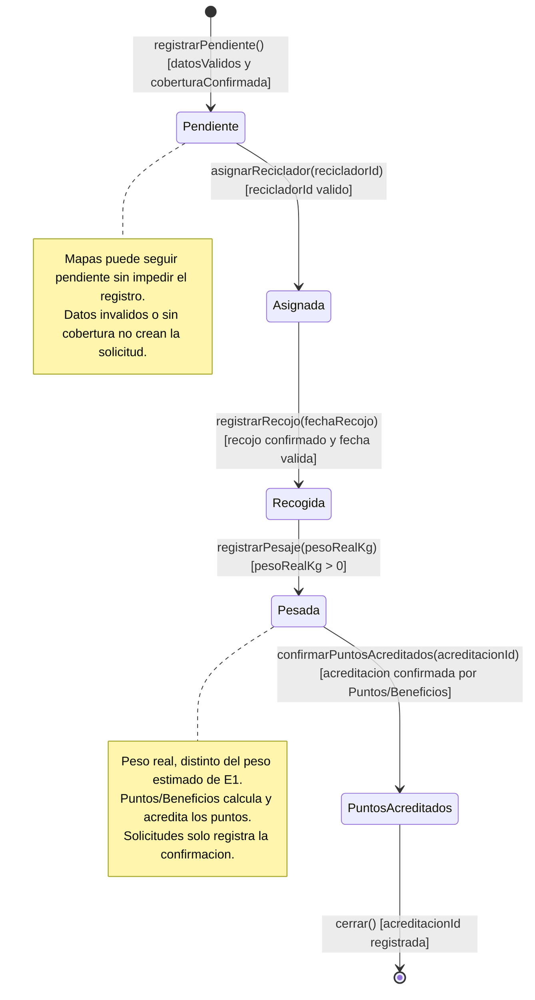

# EcoRecicla AQP — Grupo 10

## 1. Descripción del caso

EcoRecicla AQP es una propuesta de sistema orientada a apoyar la gestión del reciclaje en Arequipa. El sistema permite que los vecinos soliciten recojos de residuos reciclables, que los recicladores consulten sus rutas y registren las entregas realizadas, y que la municipalidad consulte reportes de toneladas recicladas.

El atributo de calidad crítico identificado es la **modificabilidad**, debido a que el sistema debe permitir incorporar nuevos distritos o nuevas reglas de canje de puntos en un máximo de 2 días-persona sin afectar los demás módulos.

---

## 2. Integrantes y roles

| Integrante | Rol / Responsabilidad |
|---|---|
| Paola Adamari Mayta Quispe | Diagramas arquitectónicos, despliegue y bitácora de IA |
| Joselin Sharon Condori Catunta | Drivers arquitectónicos, matriz de decisión y ADR |

## 3. Arquitectura seleccionada

Luego de evaluar las alternativas **Monolito en Capas**, **Microservicios** y **Monolito Modular**, se seleccionó **Monolito Modular**.

Esta alternativa permite mantener un único despliegue y una operación sencilla, pero separando las funcionalidades mediante módulos de dominio con límites explícitos.

Los módulos principales son:

- Solicitudes y Recojo
- Rutas y Cobertura
- Puntos y Beneficios
- Reportes de Toneladas

### Diagrama de arquitectura

---

## 4. Decisiones arquitectónicas

Las principales decisiones del proyecto se encuentran documentadas mediante ADR:

- [ADR-001 — Adopción del Monolito Modular](docs/architecture/adr/001-estilo-arquitectonico.md)
- [ADR-002 — PostgreSQL con esquemas aislados por módulo](docs/architecture/adr/002-base-de-datos.md)
- [ADR-003 — Progressive Web App (PWA)](docs/architecture/adr/003-aplicacion-frontend.md)

---

## 5. Alternativa descartada

Como segunda alternativa se evaluó un **Monolito en Capas**. Aunque ofrece simplicidad y rapidez inicial, se descartó frente al Monolito Modular debido a que este último permite establecer límites de dominio más explícitos y responde mejor al atributo crítico de modificabilidad.

---

## 6. Diagrama de despliegue

El despliegue propuesto utiliza un VPS para alojar la PWA, la API REST y el Monolito Modular. PostgreSQL almacena los datos mediante esquemas por módulo y el sistema se comunica mediante HTTPS con servicios externos de mapas/geolocalización y WhatsApp Business API.

---

## 7. Diseño UML (Lab 05)

En esta sección se consolidan los artefactos de diseño orientado a objetos y modelado UML 2.5.1 desarrollados para el módulo de **Solicitudes de Recojo**:

### Diagrama de Estados de la Solicitud

### Índice de Entregables de Diseño y Diagramas (E1 al E7)

| Entregable | Artefacto / Diagramas de Diseño | Enlaces a Archivos |
|---|---|---|
| **E1** | Historia de Usuario y Diagrama de Clases | [`docs/design/historia.md`](docs/design/historia.md) \| [`docs/design/clases.puml`](docs/design/clases.puml) \| [`docs/design/img/clases-solicitudes.png`](docs/design/img/clases-solicitudes.png) |
| **E2** | Diagrama de Secuencia (Solicitar Recojo) | [`docs/design/secuencia-solicitar-recojo.puml`](docs/design/secuencia-solicitar-recojo.puml) \| [`docs/design/img/secuencia-solicitar-recojo.png`](docs/design/img/secuencia-solicitar-recojo.png) |
| **E3** | Máquina de Estados (Ciclo de Vida) | [`docs/design/estados-solicitud.mmd`](docs/design/estados-solicitud.mmd) \| [`docs/design/img/estados-solicitud.png`](docs/design/img/estados-solicitud.png) |
| **E4** | Diagrama de Actividades (Recorrido del Reciclador) | [`docs/design/actividades-ruta-diaria.puml`](docs/design/actividades-ruta-diaria.puml) \| [`docs/design/img/actividades-ruta-diaria.png`](docs/design/img/actividades-ruta-diaria.png) |
| **E5** | Diagrama de Paquetes (Regla C4 - Sin Ciclos) | [`docs/design/paquetes.puml`](docs/design/paquetes.puml) \| [`docs/design/img/paquetes.png`](docs/design/img/paquetes.png) |
| **E6** | Esqueleto Python y Análisis Round-Trip | [`src/solicitudes/dominio.py`](src/solicitudes/dominio.py) \| [`docs/design/round-trip.md`](docs/design/round-trip.md) \| [Diagrama inverso](docs/design/classes_solicitudes.puml) \| [Imagen inversa](docs/design/img/classes_solicitudes.png) |
| **E7** | Auditoría de Consistencia C1–C5 | [`docs/design/consistencia.md`](docs/design/consistencia.md) |

---

## 8. Uso de Inteligencia Artificial

Durante el laboratorio se utilizó IA como herramienta de apoyo para analizar alternativas arquitectónicas, revisar decisiones, generar propuestas de Diagram as Code y realizar la ingeniería directa e inversa (Round-Trip).

Todas las propuestas fueron verificadas y auditadas por el equipo antes de ser aceptadas. Los registros detallados se encuentran en:

- [Bitácora de uso de IA — Lab 04 (Arquitectura)](docs/architecture/bitacora-ia.md)
- [Bitácora de uso de IA — Lab 05 (Diseño UML)](docs/design/bitacora-ia.md)

---

## 9. Reflexión del equipo

El desarrollo de este laboratorio nos permitió comprender que seleccionar una arquitectura no consiste únicamente en elegir la tecnología más avanzada, sino en analizar los requisitos, atributos de calidad y restricciones reales del proyecto. La matriz de decisión nos ayudó a comparar las alternativas de manera más objetiva y justificar la elección del Monolito Modular. También aprendimos a documentar las decisiones mediante ADR y a representar la arquitectura utilizando Mermaid, PlantUML y Python Diagrams.

Asimismo, la integración del diseño UML en el Laboratorio 05 nos enseñó la importancia de conectar las decisiones de arquitectura de alto nivel con la estructura del código mediante técnicas de Round-Trip, verificando que los diagramas mantengan consistencia estricta con las reglas del dominio (C1 a C5). El uso de IA permitió acelerar algunas actividades, pero comprobamos que sus propuestas deben ser verificadas minuciosamente antes de incorporarlas al proyecto. Finalmente, entendimos la importancia de mantener los diagramas, código y decisiones arquitectónicas versionados conjuntamente en el repositorio.
