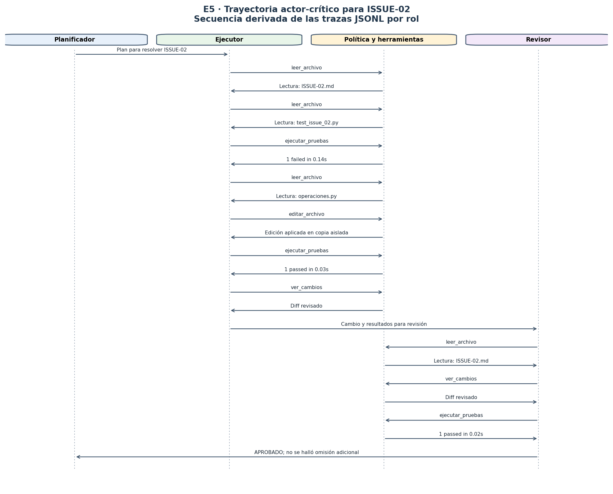

# E7: observación de las ejecuciones

## Método de lectura

Las métricas se calcularon desde las trazas JSONL conservadas de E2, E4 y E5.
**Pasos** cuenta decisiones de acción y respuesta final; no cuenta el objetivo
inicial. Las ejecuciones sin coordinación muestran “No aplica” en rondas. En la
variante actor-crítico, los pasos suman los tres roles y el contexto final suma
los historiales finales independientes de planificador, ejecutor y revisor. Las
decisiones rechazadas y las acciones bloqueadas cuentan eventos con estado
`CONTRATO_INVALIDO` y `BLOQUEADO`, respectivamente.

## Métricas por issue

| Issue / entrega | Pasos | Rondas | Herramientas usadas | Rechazos de contrato | Acciones bloqueadas | Contexto final (caracteres) |
|---|---:|---:|---|---:|---:|---:|
| Issue 1 / E2, ReAct | 8 | No aplica | `leer_archivo`, `editar_archivo`, `ejecutar_pruebas`, `ver_cambios` | 0 | 0 | 6 965 |
| Issue 2 / E5, agente único | 8 | No aplica | `leer_archivo`, `editar_archivo`, `ejecutar_pruebas`, `ver_cambios` | 0 | 0 | 6 511 |
| Issue 2 / E5, actor-crítico | 13 | 1 | `leer_archivo`, `editar_archivo`, `ejecutar_pruebas`, `ver_cambios` | 0 | 0 | 10 796 (suma por rol) |
| Issue 3 / E4, con memoria | 11 | No aplica | `leer_archivo`, `buscar`, `mapa_repo`, `anotar`, `leer_notas`, `editar_archivo`, `ejecutar_pruebas`, `ver_cambios` | 0 | 0 | 6 517 |

Los dos registros del issue 2 corresponden a las dos ejecuciones independientes
requeridas por E5. El contexto coordinado por rol fue: planificador, 623;
ejecutor, 7 308; revisor, 2 865 caracteres. Ninguna de estas trazas históricas
incluye una edición bloqueada. E6 incorporó aprobación humana después; sus
pruebas controladas se documentan en [E6](evidencias/e6-aprobacion-humana.md), y no se
presentan como aprobaciones reales de estas ejecuciones anteriores.

## Trayectoria coordinada del issue 2

Diagrama de la traza del actor-crítico de E5:

Fuentes: [traza combinada JSONL](trazas/issue-02-orquestado.jsonl),
[Mermaid](trazas/issue-02-orquestado.mmd) y [trazas separadas por rol](trazas/issue-02-orquestado/).

## Comprobación controlada del contrato

Como evidencia adicional para E7, se reprodujo una decisión de agente que intenta
usar la herramienta inexistente `abrir_terminal`. El contrato la rechazó con el
estado `CONTRATO_INVALIDO` antes de ejecutar herramientas. Esta prueba controlada
no es una quinta ejecución de los issues ni se incluye en la tabla de métricas.
Se puede repetir con [`reproducir_validacion_contrato_e7.py`](reproducir_validacion_contrato_e7.py);
la decisión grabada está en [trayectorias](trayectorias/validacion-contrato-e7.json)
y la evidencia resultante en [JSONL](trazas/validacion-contrato-e7.jsonl) y
[Mermaid](trazas/validacion-contrato-e7.mmd).

## Observaciones

- Las tres pruebas específicas fallaron antes de corregir sus respectivos issues y pasaron después: issue 1, **40 frente a 20 puntos** al repetir una acreditación; issue 2, **SOL-02 CANCELADA** incluida en la ruta; issue 3, actualizar D01 también alteraba los puntos calculados para D02.
- No hubo decisiones rechazadas por el contrato ni acciones bloqueadas en las trazas de resolución. Esto indica que las trayectorias grabadas respetaron el protocolo y las herramientas permitidas; no demuestra que entradas futuras siempre lo harán.
- El actor-crítico utilizó 13 decisiones y 10 796 caracteres de contexto agregado, frente a 8 decisiones y 6 511 caracteres del agente único para el issue 2. El revisor confirmó la prueba y el diff, pero no detectó una omisión adicional. Para este issue acotado, el costo coordinado no produjo una mejora observada.
- Los conteos describen estas cuatro ejecuciones registradas, no una tasa general de calidad o autonomía.
